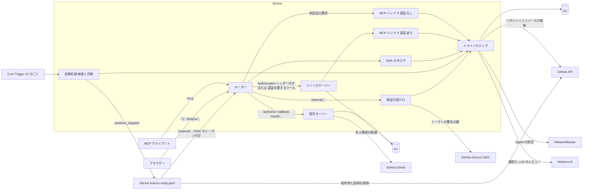

# アーキテクチャ

<picture>
  <source media="(prefers-color-scheme: dark)" srcset="../images/VST_Compatible_Logo_Steinberg_negative.png">
  
</picture>

VST® is a registered trademark of Steinberg Media Technologies GmbH.

音のプラグイン倉庫くんの構成要素と、要求の流れの仕様です。各要素の詳細は、本文中で示す設計文書に記載します。

本書は下書きです。段階 1 の検証 A1・A2 の結果と段階 2 の計画の承認を受けて確定します。

## 全体像

本サービスは、GitHub Releases で公開されたオープンソースのオーディオプラグインを検査して掲載する、非公式のレジストリです。対象の規格は VST 3・CLAP・LV2・Audio Unit です。配布物は預からず、作者が公開したファイルへ案内します。配信プラグイン倉庫くんの派生として作り、OBS に依存しない設計と判断を引き継ぎます ([ADR 0002](../decisions/0002-independent-service-derived-from-soko-kun.md))。

本サービスは、Cloudflare Workers の無料プラン上の 1 つの Worker で動作します。Worker は、MCP エンドポイント・OAuth の認可サーバー・Web カタログ・定期処理・配布物の検証の受け口を兼ねます。永続データは D1 に置き、OAuth の状態は KV に置きます。Workers AI は、プラグインの概要の機械翻訳と、新しい版の開発の実践の LLM によるレビューに使います。

配布物を取得して行う処理は、Worker の外で行います。対象は、証明の署名の検証・中身の検査・macOS の署名と公証の判定の 3 つです。Worker の CPU 時間は 1 回の起動あたり 10 ms で、配布物の取得と展開は収まりません。そのため、本サービスのリポジトリの GitHub Actions のワークフロー `verify.yaml` が配布物を取得して処理し、結果を Worker へ送ります。配信プラグイン倉庫くんの `verify.yaml` は、証明の検証のために配布物を最大 1 GiB まで取得しています。本サービスでは、同じジョブで中身の検査も行います。macOS の署名と公証の判定は、macOS のランナーの別のジョブで行う方針です。具体的な判定の方法は、中身の検査が検証 A1、macOS の判定が検証 A2 で確定します。

単一の Worker にまとめるのは、構成要素と運用の手間を最小にするためです。MCP と Web は共通のドメインロジックを使います。そのため、検索の条件や掲載状態の算出が経路によって食い違うことはありません。

本サービスは、プラグインの情報の正を GitHub に置きます。D1 が保持するのは、GitHub から取得した情報の写しと、本サービス固有の情報です。固有の情報は、検査結果・中身の検査の結果・署名と公証の判定の結果・新しい版の検査とレビューの結果・証明の検証の結果・管理停止・止めた版の記録・掲載の期間・旧い URL の ID・登録の記録・レート制限の記録・概要の機械翻訳・ロゴと説明の画像・ダウンロード数の日ごとの記録です。

## 要求の流れ

ルーターは、OAuth のメタデータを除く要求について、振り分ける前に送信元 IP アドレスごとのレート制限を確かめます。上限は経路ごとに異なり、[認証と認可](auth.md) に記載します。

### 検索と詳細取得

MCP クライアントは、`/mcp` へ `search_plugins` または `get_plugin` を送ります。ルーターは、`Authorization` ヘッダーの無い要求を認証なしの MCP ハンドラへ渡します。ハンドラは D1 から情報を読み、掲載状態を算出して応答します。

ブラウザーからの要求も、同じドメインロジックを通ります。Web カタログは閲覧専用で、HTML を返すだけです。

### 登録と作者への結果の返却

`submit_plugin` と `list_my_plugins` の呼び出しは、ルーターがリソースサーバーへ渡します。アクセストークンを持たない要求には 401 を返し、MCP クライアントにサインインを促します。サインインの流れは [認証と認可](auth.md) に記載します。

検証を通ったトークンの要求は、認証ありの MCP ハンドラが処理します。`submit_plugin` では、ドメインロジックが GitHub API で管理権限とリポジトリの情報を確かめ、D1 に保存します。保存した直後のプラグインは検査待ちです。配布物の中身はこの時点では確かめず、定期処理と `verify.yaml` で確かめます。確認のモードの `submit_plugin` は保存せず、掲載の条件の判定と LLM のレビューの結果を返します。`list_my_plugins` は、利用者が管理者であるリポジトリのプラグインについて、版ごとの検査とレビューの結果を返します。作者への返し方は [作者へのレビューの返し方](author-feedback.md) に記載します。

### 検査と同期

Cron Trigger は 15 分ごとに Worker の定期処理を起動します。定期処理は、検査待ちの `digest` と掲載中の配布物の `digest` をスキャナーへ照会し、残りの予算で登録済みのプラグインの同期・新しい版の検査・ダウンロード数の記録・概要の機械翻訳を行います。新しい版の検査では、乗っ取りの兆候を差分からルールで判定し、Workers AI の LLM で開発の実践をレビューします。予算と処理の順序は [検査と同期](scanning.md) に記載します。

### 配布物の検証

定期処理は、毎回の最後に、検証を待つ配布物の有無を D1 で確かめます。あれば `verify.yaml` を workflow_dispatch で起動します。ワークフローは、GitHub Actions の OIDC のトークンを添えて Worker から検証を待つ配布物の一覧を受け取ります。配布物を取得して証明の署名を検証し、中身を検査し、結果を同じくトークンを添えて Worker へ送ります。macOS 向けのバンドルを含む配布物は、macOS のランナーのジョブが署名と公証を判定し、結果を同じ方法で送ります。

Worker は、GitHub が公開する鍵でトークンの署名とクレームを確かめてから一覧を返し、結果を D1 に書きます。受け付けるのは本サービスのリポジトリの main で動作する `verify.yaml` のトークンだけです。経路とトークンの条件は [検査と同期](scanning.md) に記載します。

## 外部データの扱い

GitHub と配布物から取得した文字列は、外部データとして扱います。アーカイブの中のファイル名、`Info.plist`・`manifest.ttl`・`moduleinfo.json` の内容も外部データです。MCP の応答では外部データを専用のフィールドに入れ、ツールの説明で指示として扱わないことを明記します。Web では、テンプレートの自動エスケープで無害化します。Workers AI に渡すリポジトリの内容も外部データであり、指示には中の指示に従わないことを書きます。

`verify.yaml` は、取得した配布物を展開して読むだけで、中のコードを実行しません。展開では、絶対パス・親のフォルダーを指すパス・リンクを含む項目を書き出さず、展開後の合計の大きさと項目の数に上限を設けます。上限の値は未決定で、検証 A1 で標本の大きさを測ってから決めます。

ドメインロジックは、外部への要求を `api.github.com`・`mb-api.abuse.ch`・`token.actions.githubusercontent.com` の固定のホストにだけ送ります。利用者が入力した URL からは owner と repo だけを取り出し、その URL へは要求を送りません。これにより、SSRF を防ぎます。

例外は、認可サーバーが取得する CIMD の文書です。CIMD の文書の URL は MCP クライアントが指定します。Worker の互換性フラグ `global_fetch_strictly_public` を有効にし、公開されたインターネット上のホストにだけ要求を送るようにしています。

本サービスは、プラグインのインストールやコマンドの実行の機能を持ちません。

## 引き継ぐ判断

配信プラグイン倉庫くんの判断のうち、次のものを本サービスでもそのまま採ります。本サービスの ADR は作り直さず、派生元の記録を参照します。

| 判断 | 配信プラグイン倉庫くんの記録 |
| --- | --- |
| Cloudflare Workers の無料プランで動作させる | [ADR 0001](https://github.com/AllegroMoltoV/plugin-soko-kun/blob/main/docs/decisions/0001-hosting-cloudflare-workers-free.md) |
| 認可サーバーと MCP を 1 つの Worker に同居させ、認証混在にする | [ADR 0002](https://github.com/AllegroMoltoV/plugin-soko-kun/blob/main/docs/decisions/0002-single-worker-mixed-auth.md) |
| SHA-256 を計算せず、GitHub の digest を記録する | [ADR 0003](https://github.com/AllegroMoltoV/plugin-soko-kun/blob/main/docs/decisions/0003-github-digest-without-download.md) |
| 掲載状態を保存せず算出する | [ADR 0004](https://github.com/AllegroMoltoV/plugin-soko-kun/blob/main/docs/decisions/0004-computed-listing-status.md) |
| MalwareBazaar の未登録を確定として扱う | [ADR 0005](https://github.com/AllegroMoltoV/plugin-soko-kun/blob/main/docs/decisions/0005-malwarebazaar-not-found-as-clean.md) |
| 検査と同期を Cron で非同期に進める | [ADR 0007](https://github.com/AllegroMoltoV/plugin-soko-kun/blob/main/docs/decisions/0007-asynchronous-scanning-with-cron.md) |
| 概要を Workers AI で機械翻訳する | [ADR 0010](https://github.com/AllegroMoltoV/plugin-soko-kun/blob/main/docs/decisions/0010-machine-translation-of-summaries.md) |
| プラグインの画像を Worker から配信する | [ADR 0011](https://github.com/AllegroMoltoV/plugin-soko-kun/blob/main/docs/decisions/0011-plugin-images-hosted-by-worker.md) |
| VirusTotal を照会先にしない | [ADR 0012](https://github.com/AllegroMoltoV/plugin-soko-kun/blob/main/docs/decisions/0012-drop-virustotal.md) |
| 新しい版に証明・不変・差分の検査・開発の実践のレビューを課す | [ADR 0013](https://github.com/AllegroMoltoV/plugin-soko-kun/blob/main/docs/decisions/0013-release-provenance-and-review.md) |
| 証明の署名の検証を GitHub Actions で行う | [ADR 0014](https://github.com/AllegroMoltoV/plugin-soko-kun/blob/main/docs/decisions/0014-attestation-verification-in-actions.md) |
| リポジトリの名前の変更と移管を ID で追う | [ADR 0015](https://github.com/AllegroMoltoV/plugin-soko-kun/blob/main/docs/decisions/0015-repository-rename-and-transfer.md) |

派生元の ADR 0013 のうち、署名を条件にしない判断は、macOS についてだけ本サービスの [ADR 0003](../decisions/0003-listing-conditions.md) で改めています。exe と msi を含むリリースを掲載しない判断は、同じ ADR でインストーラーを案内しない形に改めています。

## 未決定の事項

| 事項 | 決める時点 |
| --- | --- |
| 中身の検査の判定の方法と、展開の上限の値 | 検証 A1 |
| macOS の署名と公証の判定のランナー・コマンド・合格の条件 | 検証 A2 |

## 関連文書

- [データモデル](data-model.md)
- [認証と認可](auth.md)
- [検査と同期](scanning.md)
- [審査の基準](review-criteria.md)
- [作者へのレビューの返し方](author-feedback.md)
- [多言語対応](i18n.md)
- [画面構成](ui.md)
