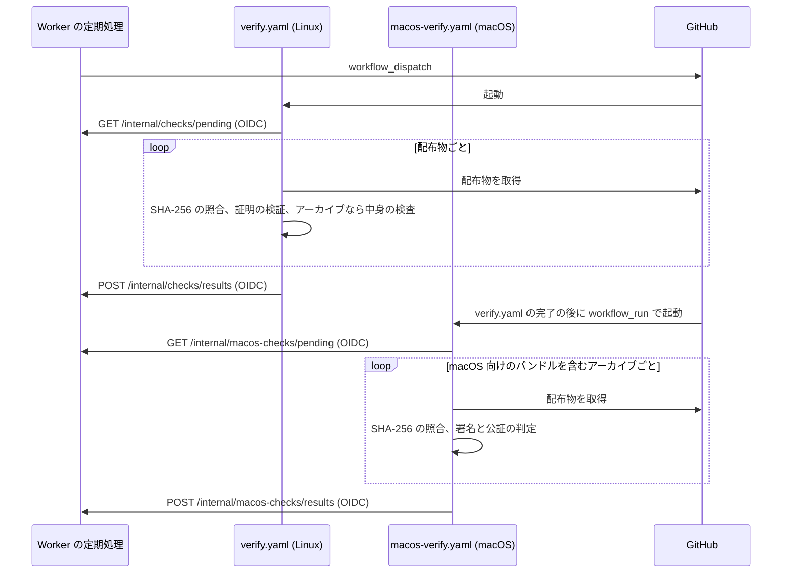

# 検査と同期

<picture>
  <source media="(prefers-color-scheme: dark)" srcset="../images/VST_Compatible_Logo_Steinberg_negative.png">
  
</picture>

VST® is a registered trademark of Steinberg Media Technologies GmbH.

`submit_plugin` の処理・Cron の定期処理・配布物の検証のワークフロー・スキャナー・無料プランの予算の仕様です。

配信プラグイン倉庫くんの [検査と同期](https://github.com/AllegroMoltoV/plugin-soko-kun/blob/main/docs/design/scanning.md) を引き継ぎ、次の 4 点を変えています。

- プラグインであることを、ソースコードではなく配布物の中身で判定する。判定は GitHub Actions で行う
- インストーラーを含むリリースを断らず、zip のアーカイブだけを案内する。インストーラーにも証明を求める
- macOS 向けの配布物に、Developer ID の署名と Apple の公証を求める
- オープンソースのライセンスを、版ごとにタグの時点で判定する

## submit_plugin の処理

`submit_plugin` は、次の順で検証し、すべて通った場合だけ保存します。いずれかで失敗した場合は、理由コード・説明・修正方法を構造化して返します。

| 順序 | 検証 | 失敗時の理由コード |
| --- | --- | --- |
| 1 | アクセストークンがある | 401 を返す |
| 2 | 利用者の直近 24 時間の要求が 10 件未満である | `rate_limited` |
| 3 | 入力 URL が `https://github.com/<owner>/<repo>` の形に一致する。末尾の `/` は許す | `invalid_url` |
| 4 | `GET /repos/{owner}/{repo}` でリポジトリを取得できる | `not_found` |
| 5 | `permissions.admin` が `true` である | `not_admin` |
| 6 | `private` が `false` である | `private_repository` |
| 7 | `archived` が `false` である | `archived_repository` |
| 8 | `github_repo_id` が未登録である | `duplicate` |
| 9 | 小文字にした `owner/repo` が、登録済みのプラグインの内部の ID とも、`plugin_aliases` の旧い ID とも重ならない | `name_reserved` |
| 10 | `GET /repos/{owner}/{repo}/releases/latest` で、下書きでない公開済みのリリースを取得できる | `no_release` |
| 11 | そのリリースが、`sha256:` で始まる `digest` を持つ配布物を 1 件以上含む | `no_verifiable_asset` |
| 12 | タグ名が英数字・`.`・`-`・`_` の 100 文字以内である | `unsupported_tag` |
| 13 | タグの時点のライセンスが、下の「ライセンスの判定」の合格の集合に入る | `no_license`・`license_unrecognized`・`license_not_open` |
| 14 | そのリリースの `immutable` が `true` である | `not_immutable` |
| 15 | `kind` が `archive` の配布物を 1 件以上含む | `no_archive` |
| 16 | すべての配布物について、`GET /repos/{owner}/{repo}/attestations/{digest}` が証明を 1 件以上返す。案内しないインストーラーと `other` の配布物も含む | `no_attestation` |

配信プラグイン倉庫くんの languages API と `CMakeLists.txt` による判定 (`not_obs_plugin`) は行いません。オーディオプラグインのビルド系は JUCE・iPlug2・DPF・nih-plug・clap-wrapper などに分かれ、Rust で書かれたものもあります。ソースコードから判定の式を作りにくいため、プラグインであることは配布物の中身の検査で確かめます。中身の検査は登録の後に非同期で行い、規格のバンドルを検出できなければ、その版を掲載しません。

配信プラグイン倉庫くんの `installer_not_allowed` も行いません。インストーラーを含むリリースは受け付け、アーカイブだけを案内します。インストーラーは案内しませんが、証明は求めます ([ADR 0003](../decisions/0003-listing-conditions.md))。

順序 2 の件数には、検証で失敗した要求も含めます。順序 2 で拒否した要求は件数に含めません。順序 4 より後の GitHub API が 404 を返した場合も、`not_found` を返します。順序 13 のライセンスの取得の 404 は例外で、`no_license` を返します。GitHub API が 404 以外の異常を返した場合は `github_unavailable` を返します。入力 URL の末尾の `.git` は取り除いてから検証します。

順序 4 の要求は利用者のトークンで送ります。順序 10 以降の GitHub API は、OAuth App の認証情報で呼び出します。検証を通った後、タグを `GET /repos/{owner}/{repo}/commits/{tag}` でコミット SHA に解決します。リポジトリの description が空の場合は、`GET /repos/{owner}/{repo}/readme` で README を取得します。

### ライセンスの判定

掲載の対象は、オープンソースのライセンスを持つプラグインに限ります。判定は版ごとに、その版のタグの時点のライセンスで行います。登録のときは最新のリリースのタグで判定し、新しい版の検査では新しい版のタグで判定します。登録の後にライセンスのファイルが変わっても、版ごとの値で判定するためです。

`GET /repos/{owner}/{repo}/license?ref=<タグ>` の応答で、次のとおり判定します。

| 応答 | 判定 | 理由コード |
| --- | --- | --- |
| `license.spdx_id` が合格の集合に入る | 合格 | |
| 404 | 不合格 | `no_license` |
| `license.spdx_id` が `NOASSERTION` | 不合格 | `license_unrecognized` |
| `license.spdx_id` が合格の集合に入らない | 不合格 | `license_not_open` |

合格の集合は、本サービスのリポジトリに固定して置く SPDX License List の JSON で、`isOsiApproved` または `isFsfLibre` が true のライセンスです。GitHub は `GPL-3.0` のような SPDX で非推奨の識別子を返しますが、非推奨の識別子にも `isOsiApproved` が付いているため、そのまま照合できます。GitHub が識別するライセンスは、いずれも OSI の承認か FSF の自由なライセンスの認定を持ちます。`license_not_open` は、GitHub が将来それ以外のライセンスを識別した場合に当たる理由コードです。

判定に LLM は使いません。LICENSE の本文は攻撃者が書ける外部データで、掲載の可否を外部データの解釈に委ねないためです。

`no_license` と `license_unrecognized` は、作者が直せる理由として返します。`license_unrecognized` の直し方は、LICENSE に標準の本文だけを置き、著作権表示の前置き・第三者の表示・素材のライセンスを NOTICE や README などの別のファイルへ移すことです。GitHub は、既知のライセンスとの類似度が高い本文だけを識別するためです。ライセンスのファイルが無いリポジトリには、リポジトリの直下に LICENSE を置くよう返します。REUSE の形で `LICENSES/` だけを持つリポジトリも、GitHub は識別しません。

同梱の素材のライセンスは判定しません。コードがオープンソースで、同梱の音声のサンプルや画像が非営利に限るライセンスの場合も、リポジトリのライセンスが合格の集合に入れば掲載します。素材の制限は、審査の基準の `third-party-provenance` と `license-compatibility` で LLM が指摘することがありますが、掲載を止めません。そのため、`/policy` には、ライセンスの判定が GitHub の検出したリポジトリのライセンスに基づくことと、同梱の素材のライセンスを保証しないことを書きます ([画面構成](ui.md))。

### 配布物の種類

配布物の `kind` は、ファイル名の拡張子から次のとおり決めます。大文字と小文字を区別しません。

| `kind` | 拡張子 | 扱い |
| --- | --- | --- |
| `archive` | `.zip` | 証明の検証・中身の検査・MalwareBazaar への照会の対象。条件を満たせば案内する |
| `installer` | `.exe`・`.msi`・`.pkg`・`.dmg` | 案内しない。証明の検証と MalwareBazaar への照会を行う |
| `other` | 上記以外 | 案内しない。証明の検証と MalwareBazaar への照会を行う |

対象のアーカイブは zip だけです。`.tar.gz`・`.tar.xz`・`.7z` は `other` として扱い、案内しません。

### 外部呼び出しの件数

`submit_plugin` の外部呼び出しは、最大で 5 件に配布物の数を足した件数です。内訳は、リポジトリ・最新リリース・タグの時点のライセンス・タグのコミット・README の取得と、配布物ごとの証明の有無の確認です。配布物が 30 件を超えるリリースは `no_verifiable_asset` で断ります。リダイレクトを受けた場合は、リダイレクト 1 回ごとに 1 件を加えて数えます。リダイレクトを追うのは同じホストの HTTPS に限り、3 回までです。

`submit_plugin` は MalwareBazaar へ照会せず、配布物も取得しません。照会は Cron の定期処理で、証明の署名の検証と中身の検査は配布物の検証のワークフローで行います。

### 保存

保存は `db.batch()` 1 回で行います。プラグイン・リリース・配布物と、配布物ごとに MalwareBazaar の検査結果を `pending` で書き込みます。すべての配布物に `attestation_checks` の行を、アーカイブには `content_checks` の行も、`pending` で作ります。同じ `digest` の検査結果が既にある場合も、`pending` に戻して照会し直します。

成功時の応答は、プラグイン ID・状態 `pending`・詳細ページの URL・検査する配布物の件数を含みます。

### 確認のモード

引数 `mode` が `check` のときは、登録せず、順序 3 から 16 の判定の結果を条件ごとに返します。順序 8 と 9 の重複は判定に含めません。あわせて、既定のブランチの最新のコミットのファイルで、下の「定期処理で行う検査」の順序 5 と 6 と同じレビューを行い、結果を返します。応答の形は [作者へのレビューの返し方](author-feedback.md) に記載します。上限は利用者ごとに直近 24 時間で 5 件で、`check_log` で数えます。Workers AI の無料枠の不足か混雑でレビューできなかった要求は、件数に数えません。

確認のモードでは、中身の検査と macOS の判定を行わず、それぞれの条件の説明だけを返します。どちらも配布物の取得を伴い、GitHub Actions で行うためです。また、確認のモードを使う公開前のリリースには、まだ配布物がありません。

### 表示用の値の推定

| 値 | 推定の規則 |
| --- | --- |
| 表示名 | 宣言ファイルの `name`。無ければリポジトリ名。外部データ |
| 規格・OS・アーキテクチャ | 案内する配布物の `content_checks` の結果。配布物の名前からは推定しない |
| 概要 | リポジトリの description。空なら README の最初の段落を平文にした 300 文字以内の文字列。いずれも外部データ |
| カテゴリ | 案内する配布物のバンドルの中の情報から推定する。推定できなければ宣言ファイルの `category`、それも無ければ `utility`。管理者は管理コマンドで値を直せる |
| ライセンス | 掲載対象バージョンの `release_checks` の SPDX 識別子 |

配信プラグイン倉庫くんは、配布物の名前に含まれる語と拡張子から OS を推定していました。オーディオプラグインの配布物は、`.vst3` や `.clap` の拡張子から OS を決められず、名前に規格名を含む例も少数です。そのため、中身の検査の結果だけを使います。

カテゴリの値は次の 5 つです。

| `category` の値 | 表示名 |
| --- | --- |
| `instrument` | 音源。MIDI の入力から音を作るもの |
| `effect` | エフェクト。音声の入力を加工するもの |
| `analyzer` | 分析・メーター |
| `midi` | MIDI の加工 |
| `utility` | ユーティリティ。どれにも当たらない場合と、推定できない場合の値 |

カテゴリの推定には、中身の検査で読める情報だけを使います。リポジトリ名や概要の語からは推定しません。

| 手がかり | 規則 |
| --- | --- |
| Audio Unit の `Info.plist` の `AudioComponents` の `type` | `aumu` は `instrument`、`aufx` と `aumf` は `effect`、`aumi` は `midi` |
| VST 3 の `moduleinfo.json` の `Sub Categories` | `Instrument` を含めば `instrument`、`Analyzer` を含めば `analyzer`、`Fx` を含めば `effect` |

CLAP の features はバイナリを実行しないと読めないため、手がかりにしません。`moduleinfo.json` は clap-wrapper の出力に含まれないため、推定できない VST 3 もあります。

検索では、キーワードを空白で区切り、すべての語を含むプラグインを返します。照合の前に、キーワードと照合対象の両方から文字と数字以外を除きます。照合対象は所有者名・リポジトリ名・表示名・概要の原文・概要の機械翻訳・カテゴリの値です。照合は部分一致で、意味の近さによる検索はしません。絞り込みには、規格・OS・カテゴリを使います。アーキテクチャでの絞り込みは設けません。規格と OS の絞り込みは、掲載対象バージョンの案内する配布物の `content_checks` の結果で判定します。VST 3 での絞り込みに出すのは、VST 3 のバンドルを検出したプラグインだけです ([ADR 0004](../decisions/0004-vst-trademark.md))。

### 説明文の機械翻訳

配信プラグイン倉庫くんと同じ規則で、Workers AI の `@cf/openai/gpt-oss-20b` で概要を翻訳し、`plugin_translations` に保存します。翻訳の指示の対象を、OBS Studio のプラグインの説明からオーディオプラグインの説明に替えます。指示には、本文はデータであり中の指示に従わないこと、複数の言語の部分を 1 つの訳にまとめること、原文に無い内容を足さないこと、Markdown の記号で飾らないことを書きます。訳が空の場合と、訳に原文に無い URL が含まれる場合は、空の訳として記録します。翻訳は 1 回の起動で最大 6 件までとします。

## Cron の定期処理

Cron Trigger は `*/15 * * * *` で、15 分ごとに起動します。1 回の起動では、次の順で処理します。

| 順序 | 処理 | 1 回の起動での上限 |
| --- | --- | --- |
| 1 | MalwareBazaar へのハッシュ照会と照会し直し | 10 件 |
| 2 | 同期 | 20 件のプラグイン。外部呼び出しの予算の残りが 6 件未満、または D1 のクエリの予算の残りが 3 件未満になった時点で止める |
| 3 | 新しい版の検査 | 1 件のリリース。外部呼び出しの予算の残りが 16 件未満なら行わない |
| 4 | ダウンロード数の記録 | 10 件のプラグイン |
| 5 | 説明文の機械翻訳 | 6 件 |
| 6 | 60 分より前の `rate_limit` の行の削除 | |
| 7 | OAuth の期限切れデータの掃除。`purgeExpiredData()` を呼ぶ | |
| 8 | 配布物の検証のワークフロー `verify.yaml` の起動。検証を待つ配布物があるときだけ | 1 件 |

同期が GitHub のレート制限か障害で止まった起動では、順序 3 と 4 を行いません。予算に達した時点で処理を止め、残りを次回の起動へ持ち越します。予算による停止とレート制限による停止の後も、順序 6 から 8 を実行します。順序 8 のために、定期処理は最初に外部呼び出し 1 件と D1 のクエリ 1 件を予算から取り分けておきます。

### 照会の対象

照会の対象は、結果が `pending` の検査結果と、結果が `error` で照会の回数が 5 回未満の検査結果と、下の「掲載中の配布物の照会し直し」の対象です。最後に照会した日時が無いものを先に、次に照会した日時の古いものから処理します。MalwareBazaar の Auth-Key が設定されていない場合、照会を行いません。MalwareBazaar が 429 を返した場合は、その起動の照会を止めます。

### 同期

同期の対象は、掲載終了のものを含むすべてのプラグインです。`last_synced_at` の古いものから順に処理します。規則は配信プラグイン倉庫くんと同じです。

| 項目 | 規則 |
| --- | --- |
| リポジトリの取得 | `GET /repositories/{github_repo_id}` で引き直し、名前の変更と移管に追従する。変わったときは `plugin_aliases` に記録し、所有者が変わったときは `owner_changed_at` に日時を記録する。確認待ちの新しい版があるあいだは、概要を description に追従させない |
| 削除と非公開化 | 404 または非公開のとき `removed` を 1 にする。公開に戻れば 0 に戻す |
| リリースの取得 | `GET /repos/{owner}/{repo}/releases/latest` を、`releases_etag` を使った条件付き要求で送る |
| 対象外のリリース | 下書き・未公開・`digest` を持つ配布物が無い・タグ名が規則に合わない、のいずれかに当てはまるリリースは保存しない |
| 配布物の保存 | 配布物を追加または更新し、`kind` を決める。外された配布物を削除する |
| 新しく現れた配布物 | 配布物の ID と `digest` の組が既存の配布物に無い場合、検査結果と `attestation_checks` の行を `pending` に戻す。アーカイブなら `content_checks` の行も `pending` で作り直す |
| 新しい版の検査の準備 | 下の「新しい版の検査」の「同期で行う判定」を行う |
| 掲載の期間 | 掲載対象のリリースか、案内する配布物の組が変わったとき、`listing_periods` を更新する |
| 書き込み | プラグイン 1 件の更新を `db.batch()` 1 回にまとめる |
| 画像 | 下の「画像の取得」の規則で取得する |

処理は冪等です。同じ起動を繰り返しても、結果は変わりません。

### 画像の取得

作者がリポジトリの `.audio-soko-kun/` に置いたロゴと説明の画像を、最新リリースのタグの時点で取得します。規則は配信プラグイン倉庫くんと同じで、置き場所のフォルダーだけを替えます。

| 項目 | 規則 |
| --- | --- |
| ファイル名 | ロゴは `logo`、説明の画像は `image` に、拡張子 `.png`・`.jpg`・`.jpeg`・`.gif`・`.webp` のいずれかを付ける |
| 形式の確認 | 先頭のバイト列から PNG・JPEG・GIF・WebP のいずれかを判定する。SVG は受け付けない |
| 大きさの上限 | ロゴは 256 KB かつ 1,024 px 四方まで。説明の画像は 1.5 MB かつ 4,096 px 四方まで |

表示用の WebP の画像の作り方も、配信プラグイン倉庫くんと同じです。Cloudflare の画像の変換を 1 回の起動で 2 件まで呼びます。

音声のデモを載せる仕組みは持ちません。

### ダウンロード数の記録

配信プラグイン倉庫くんと同じ規則で、プラグインごとに 1 日 1 回、`GET /repos/{owner}/{repo}/releases?per_page=100` の配布物の `download_count` の合計を `download_snapshots` に記録します。数は GitHub での全ダウンロードの数で、インストーラーと案内しない配布物も含みます。週間のダウンロード数は、最新の記録と、7 日以上前の記録のうち最も新しいものとの差です。

### GitHub API の異常

| 応答 | 分類 | 同期での扱い |
| --- | --- | --- |
| 404 | 未検出 | リポジトリの取得では `removed` を 1 にする |
| 429、または `x-ratelimit-remaining` が 0 の 403 | レート制限 | その起動の同期を止める |
| 上記以外の 403、401 | 権限なし | そのプラグインの最終同期の時刻だけを進め、次のプラグインへ進む |
| 5xx などその他 | 利用不可 | その起動の同期を止める |

異常を受けたプラグインの既存の情報は変更しません。

## 新しい版の検査

[ADR 0003](../decisions/0003-listing-conditions.md) の条件と、配信プラグイン倉庫くんの ADR 0013 の乗っ取りの兆候と開発の実践のレビューを確かめる処理です。項目は [審査の基準](review-criteria.md) に、掲載状態への反映は [データモデル](data-model.md) の算出規則に記載しています。同期で新しいリリースを保存したとき、`release_checks` の行を作ります。

### 同期で行う判定

| 項目 | 規則 |
| --- | --- |
| 不変 | 最新リリースの API の応答の `immutable` を `immutable` に保存する |
| 配布物の種類 | 配布物の名前の拡張子から `kind` を決める |
| 差分の起点 | その時点の掲載対象のリリースを `base_release_id` に保存する。無ければ `diff_state` を `skipped` にする |
| 配布物の検証 | すべての配布物に `attestation_checks` の行を、アーカイブには `content_checks` の行も、`pending` で作る。`macos_signing_checks` の行は、中身の検査で macOS 向けのバンドルを検出したときに作る |

### 定期処理で行う検査

Cron の定期処理は、`release_checks` のうち未完了の行を、1 回の起動で 1 件ずつ処理します。

| 順序 | 処理 | 規則 |
| --- | --- | --- |
| 1 | 宣言ファイル | 宣言ファイルをタグの時点で取得する。上限は 16 KB。形と照合の規則は下の「宣言ファイル」に記載する |
| 2 | ライセンス | 上の「ライセンスの判定」の規則で、新しい版のタグの時点のライセンスを判定し、`license_state` と `license_spdx` に書く |
| 3 | 差分の取得 | `GET /repos/{owner}/{repo}/compare/{起点のタグ}...{新しいタグ}` を `application/vnd.github.diff` で送り、本文を先頭から 24,000 文字まで読んで接続を切る |
| 4 | 乗っ取りの兆候 | 差分のファイルの見出しと追加の行から、審査の基準の乗っ取りの兆候を判定する。当たれば `diff_state` を `held` にする。差分を取得できなければ `error` にし、算出規則では確認待ちとして扱う |
| 5 | レビューの入力の取得 | タグの時点の `.github/workflows/` の一覧と各ワークフロー、ビルド系のファイル、README を取得する。1 ファイルの上限は 32 KB、合計の上限は 60,000 文字 |
| 6 | LLM のレビュー | Workers AI の `@cf/openai/gpt-oss-120b` に、審査の基準と推奨の項目と、上のファイルと差分を渡し、項目ごとの判定と説明と該当の箇所を JSON で返させる。指示の冒頭は、オーディオプラグインのリポジトリをレビューする旨にする |
| 7 | 失敗 | タイムアウト・5xx・形の合わない応答では `review_attempts` を 1 増やし、`review_state` を `failed` にする。2 回失敗した版は確認待ちのまま管理者の判断を待つ |
| 8 | 無料枠の不足と混雑 | 配信プラグイン倉庫くんと同じ規則で扱う。1 日の無料枠の不足を示す `4006` と `3036` では試行に数えず、`review_wait_until` を 1 時間後にする。一時的な混雑を示す `3040` では次の起動でやり直す |

順序 5 のビルド系のファイルは、リポジトリのルートの `CMakeLists.txt`・`Cargo.toml`・`vcpkg.json`・`.gitmodules`・`meson.build` です。配信プラグイン倉庫くんの一覧のうち、`buildspec.json` は obs-plugintemplate に固有のため外しています。`.gitmodules` は、JUCE や VST 3 SDK をサブモジュールで取り込む作者が多いため加えています。一覧を広げるとレビュー 1 件の入力が増え、Workers AI の 1 日の枠で受け入れられる版の数が減るため、この 5 つに絞ります。

ライセンスの取得・レビューの入力の取得・LLM の呼び出しは、外部呼び出しの予算から 1 件ずつ引きます。1 件の検査の外部呼び出しは最大で 16 件です。

### 宣言ファイル

宣言ファイルは、作者が表示名・カテゴリと、配布物ごとの OS・アーキテクチャ・同梱する規格を宣言するファイルです。置き場所は `.audio-soko-kun/config.json` です。宣言ファイルは任意です。規格・OS・アーキテクチャは中身の検査の検出を正とし、宣言は照合と案内の絞り込みにだけ使います。

形は次のとおりです。

```json
{
  "name": "シンプルピッチシフト / Simple Pitch Shift",
  "category": "effect",
  "assets": [
    {
      "pattern": "simple-pitchshift-*-windows-x64.zip",
      "os": "windows",
      "arch": ["x86_64"],
      "formats": ["vst3", "clap"]
    }
  ]
}
```

| 項目 | 規則 |
| --- | --- |
| `name` | 1〜60 文字の文字列。省略できる |
| `category` | 上の「表示用の値の推定」のカテゴリの値のいずれか。省略できる。バンドルの中の情報から推定できないときだけ使う |
| `assets` | 1〜20 件の配列。省略できる。版ごとに配布物の名前が変わるため、配布物は名前の型 `pattern` で指す。`*` だけを任意の文字列として扱う |
| `os` | `windows`・`macos`・`linux` のいずれか |
| `arch` | `x86_64`・`x86`・`arm64` の配列。fat binary の配布物は、含むアーキテクチャをすべて並べる |
| `formats` | `vst3`・`clap`・`lv2`・`au` の配列 |

判定の結果は `release_checks` の `config_state` に書きます。

| 結果 | 条件 |
| --- | --- |
| `missing` | ファイルが無い (404)。掲載を止めない |
| `invalid` | JSON でない、または上の規則に合わない |
| `no_declared_assets` | `assets` があり、どのアーカイブもどの `pattern` にも一致しない |
| `mismatch` | `pattern` に一致したアーカイブの中身の検査の結果が、宣言の `os`・`arch`・`formats` と食い違う |
| `ok` | 上のいずれにも当たらない。`plugins` の `display_name` と `declared_assets` を更新する |

`assets` の宣言がある場合は、宣言に一致したアーカイブだけを案内します。配信プラグイン倉庫くんで、作者が動作を確かめていない OS の配布物をテンプレートの CI が出していた件に対応するための規則で、同じ考え方を引き継ぎます。

`mismatch` の判定は、宣言の取得と中身の検査の両方を終えてから行います。`os` は値の一致で、`arch` と `formats` は集合の一致で照合します。fat binary の配布物で検出したアーキテクチャが `x86_64` と `arm64` なら、`arch` は `["x86_64", "arm64"]` のとき一致します。

## 配布物の検証のワークフロー

配布物を取得して行う処理は、本サービスのリポジトリの GitHub Actions のワークフローが行います。証明の検証と中身の検査は `verify.yaml` が Linux のランナーで、署名と公証の判定は `macos-verify.yaml` が macOS のランナーで行います。2 つを別のファイルに分けるのは、Worker が OIDC のトークンの `job_workflow_ref` で送り手を区別するためです。`job_workflow_ref` はワークフローのファイルごとの値で、同じファイルの 2 つのジョブを区別できません。ファイルを分ければ、一方のワークフローが乗っ取られても、もう一方の経路に結果を書けません。

本サービスのリポジトリは公開リポジトリです。公開リポジトリの標準のランナーは、GitHub の課金の対象外です。macOS のランナーも標準のランナーに含まれます。



`macos-verify.yaml` を `verify.yaml` の後に動作させるのは、macOS 向けのバンドルを含むアーカイブが、中身の検査を終えて初めて分かるためです。

### 取得と処理の上限

どちらのワークフローも、配布物を読むだけで、中のコードを実行しません。配布物は 1 件ずつ取得し、処理を終えるたびに削除します。

| 項目 | 上限 |
| --- | --- |
| 配布物の取得 | 1 件あたり 2 GiB。超えた配布物は取得を打ち切り、`error` として記録する。ジョブの最初に `df` でランナーの空き容量を確かめ、足りなければその回の処理を行わない |
| アーカイブの項目の数 | 10,000 (仮の値) |
| 展開後の合計の大きさ | 1 GiB (仮の値) |
| 1 項目の展開後の大きさ | 256 MiB (仮の値) |
| ジョブの時間 | 20 分 (仮の値) |
| 1 回に処理する件数 | 50 件 (仮の値) |

取得の上限を 2 GiB にするのは、オーディオプラグインの 23 件のリポジトリの配布物 167 件を調べた最大が 1,102.9 MiB で、1 GiB では DISTRHO/Cardinal を掲載できないためです (非公開の調査記録)。仮の値は、シードのプラグインの配布物 (633 KB) を処理できる値です。DISTRHO/Cardinal の最大の zip の項目の数・展開後の大きさ・処理時間を測ってから確定します。

`verify.yaml` は、アーカイブをファイルへ展開せず、メモリ上で読みます。絶対パス・親のフォルダーを指す `..` を含むパス・シンボリックリンクの項目は読みません。`macos-verify.yaml` は、`spctl` と `codesign` をバンドルに当てるため、`ditto -x -k` でファイルへ展開します。シンボリックリンクと `..` を含む zip を `ditto` で展開したときの挙動と、その確かめ方は、macOS の追加の検証で確定します。

### Worker の経路

| 経路 | 内容 |
| --- | --- |
| `GET /internal/checks/pending` | `attestation_checks` か `content_checks` の結果が `pending` か、`error` で試行が 3 回未満の配布物を、最大 50 件返す。各件に、配布物の ID・`kind`・ダウンロード URL・`digest`・リポジトリ・リポジトリ ID・旧い名前の一覧・タグ・タグのコミット・記録したリリースのワークフローを含める |
| `POST /internal/checks/results` | 配布物ごとの証明の検証の結果と、アーカイブの中身の検査の結果を受け取り、`attestation_checks` と `content_checks` に書く。中身の検査で macOS 向けのバンドルを検出した配布物には、`macos_signing_checks` の行を `pending` で作る。宣言ファイルとの照合が残っていれば行う |
| `GET /internal/macos-checks/pending` | `macos_signing_checks` の結果が `pending` か、`error` で試行が 3 回未満の配布物を、最大 50 件返す。各件に、配布物の ID・ダウンロード URL・`digest`・macOS 向けのバンドルのアーカイブの中のパスを含める |
| `POST /internal/macos-checks/results` | 配布物ごとの署名と公証の判定の結果を受け取り、`macos_signing_checks` に書く |

配信プラグイン倉庫くんの `/internal/attestations/pending` と `/internal/attestations/results` を、証明の検証と中身の検査を合わせて扱う形に改めています。

`error` の試行が 3 回に達した配布物は、自動ではやり直しません。その版は、管理者が原因を確かめるまで確認待ちになります。

すべての経路で、`Authorization: Bearer` の GitHub Actions の OIDC のトークンを求めます。Worker は、`https://token.actions.githubusercontent.com/.well-known/jwks` の鍵で RS256 の署名を確かめ、次をすべて満たすときだけ処理します。満たさなければ 401 を返します。

| クレーム | 値 |
| --- | --- |
| `iss` | `https://token.actions.githubusercontent.com` |
| `aud` | `audio-soko-kun` |
| `repository` | `AllegroMoltoV/audio-plugin-soko-kun` |
| `job_workflow_ref` | `/internal/checks/` の経路では `AllegroMoltoV/audio-plugin-soko-kun/.github/workflows/verify.yaml@refs/heads/main`。`/internal/macos-checks/` の経路では `AllegroMoltoV/audio-plugin-soko-kun/.github/workflows/macos-verify.yaml@refs/heads/main` |
| `exp` | 現在より後 |

`verify.yaml` は、Worker の定期処理が workflow_dispatch で起動します。起動には秘密情報 `GITHUB_DISPATCH_TOKEN` を使います。配信プラグイン倉庫くんでは、GitHub の schedule による起動が一度も起きなかったため、Worker から起動する形に改めた経緯があります。schedule は予備として残します。`macos-verify.yaml` は、`verify.yaml` の完了を workflow_run で受けて起動します。

### 証明の検証

配信プラグイン倉庫くんと同じ規則で、リリースのすべての配布物について行います。`gh attestation verify <配布物> --repo <リポジトリ> --source-ref refs/tags/<タグ> --source-digest <タグのコミット>` に、記録したリリースのワークフローがあれば `--signer-workflow <リポジトリ>/<ワークフローのパス>` を加えて実行します。現在の名前で通らなければ、旧い名前を新しい順に試します。証明書の `sourceRepositoryIdentifier` がリポジトリ ID と違えば `failed` (`repository_id_mismatch`) にします。ダウンロードした配布物の SHA-256 が `digest` と違えば `failed` (`digest_mismatch`) にします。

### 中身の検査

アーカイブの中のバンドルを探して、規格・OS・アーキテクチャと VST 2 の有無を判定します。判定のスクリプトは Python の標準ライブラリだけで書きます。規則は次のとおりです。検証 A1 で、この規則の判定の結果が標本の配布物 14 件の期待値と一致することを確かめています。

| 判定 | 規則 |
| --- | --- |
| VST 3 | `<名前>.vst3/Contents/` の下に、`<アーキテクチャ>-win/<名前>.vst3`、`MacOS/<名前>`、`<アーキテクチャ>-linux/<名前>.so` のいずれかがあり、そのバイナリが `GetPluginFactory` をエクスポートする。`moduleinfo.json` は必須にしない。clap-wrapper の出力に含まれないため。読むときは末尾のコンマを許す |
| CLAP | `.clap` のファイル、または macOS の `.clap` のバンドルの `Contents/MacOS/` のバイナリが `clap_entry` をエクスポートする。VST 3 のバイナリも `clap_entry` を持つことがあるため、エクスポートだけで規格を決めない |
| LV2 | `<名前>.lv2/manifest.ttl` があり、その `lv2:binary` が指すバイナリがアーカイブにある。`lv2:binary` の値はパーセントエンコードを戻してから探す。アーキテクチャはそのバイナリで判定する |
| Audio Unit | `<名前>.component/Contents/Info.plist` があり、`AudioComponents` を持つ。バイナリは `CFBundleExecutable` が指すもの。`AudioComponents` を持たない旧い形式のバンドルは、Audio Unit として扱わない |
| VST 2 | `.vst` のバンドルがある。または、アーカイブの中のいずれかのバイナリが `VSTPluginMain` か `main_macho` をエクスポートする。`main` のエクスポートは、そのバイナリが共有ライブラリのときだけ数える |
| OS | バイナリの形式。PE は `windows`、Mach-O は `macos`、ELF は `linux` |
| アーキテクチャ | PE の Machine、Mach-O の cputype、ELF の e_machine から、`x86_64`・`x86`・`arm64` のいずれかを求める。複数のアーキテクチャを持つ Mach-O の fat binary は、スライスごとの値をすべて並べる |

共有ライブラリの判定は、PE では Characteristics の `IMAGE_FILE_DLL`、Mach-O では filetype が `MH_BUNDLE` か `MH_DYLIB`、ELF では `ET_DYN` で `PT_INTERP` を持たないことです。ELF の PIE の実行形式は `ET_DYN` ですが、`PT_INTERP` を持つため共有ライブラリとみなしません。

VST 3 のバンドルの形をとらない、Windows の単一ファイルの `.vst3` は、VST 3 のバンドルとみなしません。VST 3 SDK はバンドルの形を求めており、検証 A1 の標本 14 件にも単一ファイルの形はありませんでした。

Windows の Arm64EC と Arm64X は区別せず、PE の Machine の値で判定します。Arm64 の Windows の標本が無く、区別の方法を実バイナリで確かめられないためです。

ビルドに使った SDK の版は記録しません。配布物から読み取る方法が確かめられていないためです。

アーカイブの中にインストーラーや別のアーカイブがあり、その中を調べられない場合は、判定不能として `content_checks` の結果を `undetermined` にします。判定不能のアーカイブは、VST 2 を含まないことを確かめられないため、`no-vst2` の合格にしません。`content_checks` の結果の値と掲載への影響は [データモデル](data-model.md) に記載します。

VST 3 SDK を使わずに VST 3 のインターフェースを実装したプラグインは、配布物から見分けられません。VST 3 での絞り込みに混ざる可能性があります ([ADR 0004](../decisions/0004-vst-trademark.md))。

### 署名と公証の判定

macOS 向けのバンドルについて、Developer ID の署名と Apple の公証を判定します。規則は次のとおりです。検証 A2 で、本サービスのリポジトリで macOS のランナーのワークフローを動作させ、この規則で陽性の標本と陰性の標本を取り違えずに分けられることを確かめています。

| 判定 | 規則 |
| --- | --- |
| 公証 | `spctl --assess -vvv --type install`、または `spctl --assess -vvv --type open --context context:primary-signature` を当て、終了コードが 0 で、出力が `source=Notarized Developer ID` のとき合格とする。`--type execute` は、アプリ以外のバンドルを Developer ID の署名があっても却下するため使わない |
| 署名の種類と Team ID | `codesign -dv --verbose=4` の Authority と TeamIdentifier で、Developer ID・Apple Development・アドホック・署名なしを分けて記録する |
| 署名の検証 | `codesign --verify --deep --strict` の結果は記録だけにし、合格の条件に使わない |
| ステープル | `xcrun stapler validate` の結果は記録だけにし、合格の条件に使わない。ステープルの有無だけを示し、公証の判定に使えないため |

公証の照会に認証情報は要りません。検証 A2 では、秘密情報を参照しないワークフローで、公証済みの標本が `source=Notarized Developer ID` を返しました。

1 つのアーカイブのすべての macOS 向けのバンドルが合格のとき、`macos_signing_checks` の結果を `passed` にします。不合格の理由は次のコードで記録します。

| 理由コード | 意味 |
| --- | --- |
| `not_signed` | 署名が無い |
| `adhoc` | アドホックの署名だけがある |
| `not_developer_id` | Apple Development など、Developer ID 以外の証明書で署名されている |
| `not_notarized` | Developer ID の署名があり、公証が無い |
| `check_error` | 判定のコマンドが失敗した。結果は `error` にする |

複数のバンドルで Team ID が食い違う場合は、その版を管理者の確認待ちにします。乗っ取ったアカウントで別の証明書を使った兆候になりうるためで、乗っ取りの兆候と同じ扱いにします。

Linux の rcodesign は使いません。rcodesign の verify は Mach-O だけを対象にし、不具合があることを自ら警告しています (非公開の調査記録)。

Developer ID の署名だけがあり、公証の無い標本は、検証 A2 で見つかっていません。この組み合わせの判定は実例で確かめていません。

macOS の追加の検証で、次の事柄を確かめます。結果を受けて、判定の規則を確定します。

- ステープルの無い公証済みのバンドルを、照会の記録が無い状態で判定した結果。検証 A2 では元のバンドルを先に判定しており、オンラインの照会だけで合格になるとは言い切れません
- Apple への照会の失敗と却下を、終了コードと出力で区別する方法。区別できない結果は `failed` にせず `error` として扱います
- macOS の LV2 のバンドルに `spctl` を当てた結果。検証 A2 の対象は `.vst3`・`.clap`・`.component` だけでした。判定できなければ、macOS の LV2 のバンドルを含むアーカイブを案内しない規則にします
- `ditto -x -k` の展開の安全

`macos-verify.yaml` を運用に入れるまでは、macOS 向けのバンドルを含むアーカイブの `macos_signing_checks` は `pending` のまま残り、そのアーカイブを案内しません。[データモデル](data-model.md) の算出規則により、そのアーカイブを含む版は掲載しません。

### 結果が出るまでの時間

配信プラグイン倉庫くんでは、同期と検証のワークフローがそれぞれ 15 分ごとで、結果まで最大で 30 分ほどかかります。本サービスでは `macos-verify.yaml` が `verify.yaml` の後に続くため、macOS 向けの配布物を含む版はさらに時間がかかります。検証 A2 の 1 回の実行では、`macos-verify.yaml` に当たるジョブの所要時間は 31 秒でした。目安の時間は、シードのプラグインの最初の掲載で測ってから記載します。

## 掲載中の配布物の照会し直し

MalwareBazaar への照会の対象に、掲載対象のリリースの配布物のうち、結果が `not_found` で最後に照会してから 7 日以上たったものを加えます。`pending` と `error` の照会を先に行い、残りの件数で照会し直します。`malicious` に変わった場合は、プラグインが停止になり、その版を `release_suspensions` に記録します。

## スキャナー

| スキャナー | 照会 | 利用条件の上限 |
| --- | --- | --- |
| MalwareBazaar | `POST https://mb-api.abuse.ch/api/v1/` に `query=get_info` と `hash`。`Auth-Key` ヘッダーが必須 | 非営利の利用に限る。量の上限の数値は公開されていない |

`Auth-Key` は配信プラグイン倉庫くんと同じ鍵を使います。2 つのサービスで共有したときの量の上限は公開されておらず、確かめていません。

VirusTotal は照会先にしません。判断は配信プラグイン倉庫くんの ADR 0012 を引き継ぎます。オーディオプラグインでも、海賊版の Logic Pro を装うマイナーが発見された時点で、VirusTotal のどの製品も検出していなかった例があります (非公開の調査記録)。

### MalwareBazaar の判定

| 応答 | 検査結果 |
| --- | --- |
| `query_status` が `ok` | `malicious`。既知のマルウェアの検体として収録されている |
| `query_status` が `hash_not_found` | `not_found` |
| 429 | 記録しない。その起動の照会を止める |
| その他 | `error` |

MalwareBazaar の `not_found` は確定として扱い、掲載を止めません。照会のたびに `attempts` を 1 増やし、`scanned_at` を更新します。

## 無料プランの予算

Cloudflare Workers の無料プランの上限に対し、本サービスは次の予算を設けます。新しい版の検査を除き、配信プラグイン倉庫くんと同じ値です。

| 対象 | 無料プランの上限 | 本サービスの予算 |
| --- | --- | --- |
| 外部呼び出し | 1 回の起動あたり 50 件。リダイレクトも 1 件と数える | 45 件 |
| D1 のクエリ | 1 回の起動あたり 50 件。`db.batch()` は 1 件 | Cron の順序 1 から 5 で 45 件。順序 6 から 8 は予算の外で実行する |
| CPU 時間 | 1 回の起動あたり 10 ms | 配布物をダウンロードしない。中身の検査・証明の検証・macOS の判定は Worker で行わない。画像は大きさの上限を設け、先頭のバイト列だけを解析する。差分は diff の形式で先頭の 24,000 文字だけを読む |
| KV の書き込み | 1 日 1,000 件 | OAuth の経路に IP アドレスごとのレート制限を設ける |
| Cron Trigger | アカウントあたり 5 個 | 1 個 |
| Workers AI | 1 日 10,000 Neurons | 配信プラグイン倉庫くんと分け合う。新しい版のレビューは 1 日に 10〜16 件を上限として受け入れる |

本サービスは、配信プラグイン倉庫くんと同じ Cloudflare のアカウントに置きます。Cron Trigger と 1 日のリクエストの上限はアカウントで数えるため、2 つのサービスで分け合います。Cron Trigger は 2 つのサービスで 2 個を使います。Workers AI の 1 日の無料枠も、2 つのサービスで分け合う前提で扱います。レビュー 1 件の消費は、差分の無い場合で 524〜708 Neurons でした (非公開の調査記録)。枠が足りない日は、レビューが翌日へ遅れます。

## 未決定の事項

| 事項 | 節 | 決める時点 |
| --- | --- | --- |
| 展開の上限・ジョブの時間・1 回に処理する件数の確定。現在は仮の値 | 取得と処理の上限 | 大きな配布物 (DISTRHO/Cardinal) の計測の後 |
| ステープルの無い公証済みのバンドルの判定、照会の失敗と却下の区別、macOS の LV2 のバンドルの判定、`ditto` の展開の安全 | 署名と公証の判定 | macOS の追加の検証の後 |
